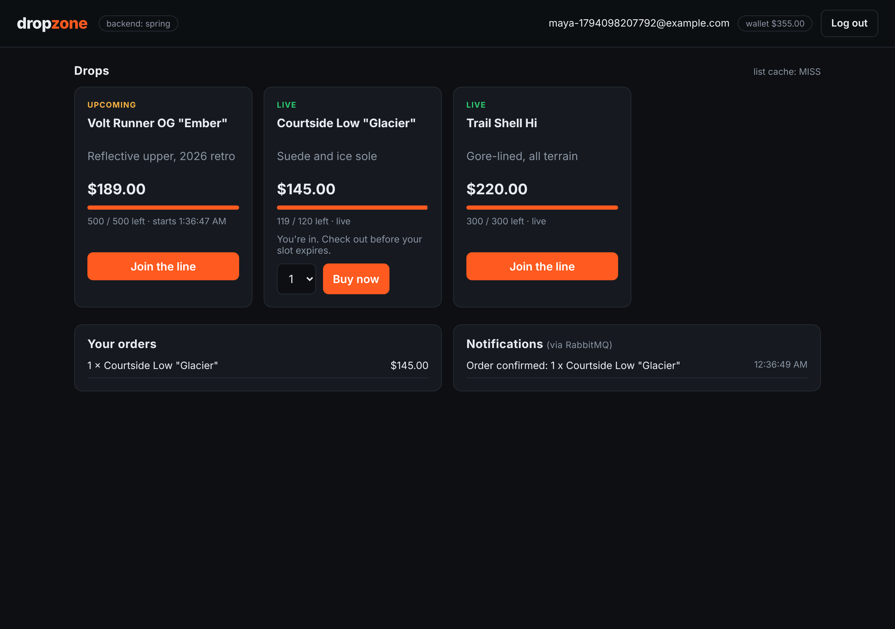
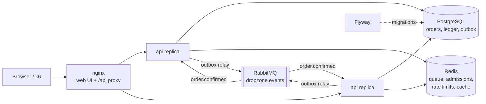

# dropzone

A limited-drop marketplace built to survive a stampede: 500 pairs go on sale, 10,000 people (and their bots) rush in, and nobody gets oversold, double-charged or skipped in line.

The same API is implemented three times, in **Spring Boot**, **Node.js/Express** and **ASP.NET Core**, on one shared PostgreSQL schema. You pick the backend with one environment variable, and one black-box test suite proves all three behave identically.


## Introduction

Flash sales are a classic backend problem: a short burst of extreme concurrency against a tiny amount of stock, real money moving, and clients that retry aggressively. dropzone handles the whole flow:

1. **Waiting room.** Shoppers join a first-come queue in Redis. A background admitter lets a batch in every second once the drop is live, so the checkout never sees the full stampede.
2. **Checkout.** One PostgreSQL transaction decrements stock with a conditional update (it cannot go below zero), debits the wallet under a row lock, writes balanced double-entry ledger legs, records the order and an outbox event, and stores the response for idempotent replays.
3. **Events.** A publisher relays the outbox to RabbitMQ, and a consumer turns `order.confirmed` events into notifications.

What it shows:

| Concern | How |
| --- | --- |
| Correctness under concurrency | Conditional `UPDATE ... WHERE remaining_stock >= n`, `SELECT ... FOR UPDATE` on wallets, a DB `CHECK` as the last line of defence |
| Money | Double-entry ledger; a deferred constraint trigger rejects any transaction whose legs don't sum to zero |
| Safe retries | `Idempotency-Key` header with stored responses, advisory locks for concurrent duplicates, 422 on key reuse with a different body |
| Reliable messaging | Transactional outbox, `FOR UPDATE SKIP LOCKED` relay, publisher confirms, idempotent consumer |
| Traffic shaping | Redis waiting room, per-user fixed-window rate limiting with `Retry-After` |
| Caching | Cache-aside drop list in Redis with invalidation on writes (`X-Cache: HIT/MISS`) |
| Auth | Stateless JWT (HS256) with `customer` and `admin` roles; a token from one backend works on the others |
| API design | OpenAPI 3 contract, RFC 7807 problem responses with machine-readable codes |
| Operations | Flyway migrations, Docker Compose, horizontal scaling behind nginx, k6 load test, GitHub Actions |

## Interface



The web UI (plain HTML and JavaScript, served by nginx) lets you register, join a drop's line, watch your place, buy when admitted, and see notifications arrive through RabbitMQ. Admins can schedule new drops. The header shows which backend is answering.

The REST API is documented in [`contract/openapi.yaml`](contract/openapi.yaml). Paste it into [editor.swagger.io](https://editor.swagger.io) to browse it. The main endpoints:

| Method | Path | Notes |
| --- | --- | --- |
| `POST` | `/api/auth/register`, `/api/auth/login` | Returns `{ token, user }`. New accounts get signup credit. |
| `GET` | `/api/me`, `/api/me/notifications` | Profile with wallet balance; notifications from the queue |
| `GET` | `/api/drops`, `/api/drops/{id}` | Public. The list is cached in Redis. |
| `POST` | `/api/drops` | Admin only |
| `POST` / `GET` | `/api/drops/{id}/queue` | Join (idempotent, rate limited) / poll your place |
| `POST` | `/api/orders` | Requires admission and an `Idempotency-Key` header |
| `GET` | `/api/orders` | Your orders |

Errors look like this everywhere:

```json
{ "type": "about:blank", "title": "Not enough stock left", "status": 409, "code": "SOLD_OUT" }
```

## Architecture



The API instances are stateless: everything shared lives in PostgreSQL or Redis, and the background jobs (admitter, outbox publisher, consumer) are safe to run on every replica at once. `docker compose up --scale api=3` runs three of them behind nginx.

**Checkout, step by step** (one transaction; any failure rolls back everything):

1. `pg_advisory_xact_lock` on (user, idempotency key), then re-check for a stored response. Concurrent retries of the same request collapse into one purchase.
2. Reject a second order for the same drop (also enforced by a unique constraint).
3. `UPDATE drops SET remaining_stock = remaining_stock - n WHERE id = ? AND remaining_stock >= n`. Zero rows means sold out.
4. `SELECT ... FROM accounts WHERE user_id = ? FOR UPDATE`, then check the balance.
5. Insert the order, the ledger transaction and its two legs, and update both cached balances.
6. Insert an `order.confirmed` row into `outbox_events` and the response into `idempotency_keys`.

**Schema** ([`db/migrations`](db/migrations)): `users`, `accounts` (customer wallets plus `promo` and `revenue` system accounts), `ledger_transactions`, `ledger_entries`, `drops`, `orders`, `idempotency_keys`, `outbox_events`, `notifications`.

## Modular backend

Three interchangeable implementations of the same contract:

| | Spring Boot | Express | ASP.NET Core |
| --- | --- | --- | --- |
| Folder | [`backends/spring`](backends/spring) | [`backends/express`](backends/express) | [`backends/dotnet`](backends/dotnet) |
| Language | Java 21 | TypeScript (Node 22) | C# 12 (.NET 8) |
| HTTP | Spring MVC | Express 4 | Minimal APIs |
| Data access | `JdbcClient` + `@Transactional` | `pg` | Npgsql + Dapper |
| Auth | Spring Security OAuth2 resource server | `jsonwebtoken` middleware | JwtBearer + policies |
| Redis | Spring Data Redis | ioredis | StackExchange.Redis |
| RabbitMQ | Spring AMQP (`@RabbitListener`) | amqplib | RabbitMQ.Client |
| Background jobs | `@Scheduled` | timer loops | `BackgroundService` |
| Unit tests | JUnit 5 + AssertJ | Vitest | xUnit |

What makes them interchangeable:

- **One schema, migrated once.** Flyway applies `db/migrations` before any backend starts; no backend owns the schema.
- **One contract.** [`contract/openapi.yaml`](contract/openapi.yaml) fixes paths, payloads, status codes and error codes.
- **Shared conventions.** The same Redis key names (`dz:queue:{drop}`, `dz:admitted:{drop}:{user}`, `dz:rl:{user}:{window}`), the same RabbitMQ exchange and queue, the same JWT claims (`sub`, `email`, `role`, `iss=dropzone`), and the same request fingerprint for idempotency (`sha256("{dropId}|{quantity}")`). Each backend's unit tests pin that hash to the same value.
- **One test suite.** [`tests/contract`](tests/contract) talks only HTTP, and CI runs it against every backend.

Switching is one variable:

```bash
BACKEND=express docker compose up --build
```

## Usage

### Quick start

You need Docker with Compose v2.

```bash
git clone https://github.com/Khalil002/dropzone.git
cd dropzone
docker compose up --build
```

Open <http://localhost:8080>. Log in as the demo admin (`admin@dropzone.local` / `admin1234`) to schedule a drop, then register a second account in a private window to buy it. The default backend is Spring Boot.

### Self-hosting guide

1. **Install Docker.** Docker Desktop on macOS or Windows, or Docker Engine plus the Compose plugin on Linux. Check with `docker compose version`.
2. **Get the code.** `git clone https://github.com/Khalil002/dropzone.git && cd dropzone`
3. **Configure.** `cp .env.example .env`, then edit `.env`:
   - `BACKEND`: `spring`, `express` or `dotnet`.
   - `JWT_SECRET`: set a long random value, for example from `openssl rand -hex 32`. It must be at least 32 characters.
   - `DB_PASSWORD`: change it from the default.
   - `WEB_PORT`: the port the site listens on (default 8080).
4. **Start it.** `docker compose up -d --build`. The first build downloads dependencies and takes a few minutes. Later starts take seconds.
5. **Check it.** `curl http://localhost:8080/api/health` should return `{"status":"ok","backend":"..."}`.
6. **Change the admin password.** The demo admin comes from the first migration. Register your own account, then promote it and remove the demo one:
   ```bash
   docker compose exec postgres psql -U dropzone -c "UPDATE users SET role = 'admin' WHERE email = 'you@example.com';"
   docker compose exec postgres psql -U dropzone -c "DELETE FROM users WHERE email = 'admin@dropzone.local';"
   ```
7. **Expose it (optional).** Put a TLS-terminating reverse proxy such as Caddy or Traefik in front of port 8080. Only the `web` service needs to be reachable; RabbitMQ's management UI on 15672 should stay private (remove its port mapping, or firewall it).
8. **Operate it.**
   - Logs: `docker compose logs -f api`
   - Scale out: `docker compose up -d --scale api=3`
   - Switch backend: change `BACKEND` in `.env`, then `docker compose up -d --build api`
   - Back up: `docker compose exec postgres pg_dump -U dropzone dropzone > backup.sql`
   - Stop: `docker compose down` (add `-v` to delete the data too)

### Configuration

| Variable | Default | Meaning |
| --- | --- | --- |
| `BACKEND` | `spring` | Which implementation to build and run |
| `WEB_PORT` | `8080` | Host port for the UI and API |
| `JWT_SECRET` | dev value | HS256 signing secret shared by every replica |
| `SIGNUP_CREDIT_CENTS` | `50000` | Wallet credit for new accounts |
| `ADMIT_BATCH` / `ADMIT_INTERVAL_MS` | `50` / `1000` | How many people the waiting room admits, and how often |
| `RATE_LIMIT_MAX` / `RATE_LIMIT_WINDOW_SEC` | `20` / `10` | Per-user limit on queue joins and checkouts |
| `CACHE_TTL_SEC` | `2` | Lifetime of the cached drop list |

### Running a backend from source

Start only the infrastructure, with its ports on localhost:

```bash
docker compose -f docker-compose.yml -f docker-compose.dev.yml up -d postgres redis rabbitmq migrate
```

Then run one backend on port 8000:

```bash
cd backends/express && npm install && npm run dev        # Node 22
cd backends/spring && mvn spring-boot:run                  # Java 21
cd backends/dotnet && dotnet run --project src/Dropzone.Api # .NET 8
```

### Load test

The k6 script registers a crowd, points it at one drop and checks that exactly `STOCK` orders succeed while everyone else is turned away cleanly:

```bash
docker compose up -d --build --scale api=3
USERS=1000 STOCK=100 docker compose --profile loadtest run --rm k6
```

## Testing

| Suite | Command | What it covers |
| --- | --- | --- |
| Contract (all backends) | `cd tests/contract && npm install && API_URL=http://localhost:8080/api npm test` | 23 black-box tests: auth, RBAC, validation, caching, queue order, admission, rate limiting, idempotent replays, concurrent retries, insufficient funds rollback, no overselling under a 15-buyer race, notification delivery |
| Express unit | `cd backends/express && npm test` | Business rules, schemas, JWT middleware, problem rendering |
| Spring unit | `cd backends/spring && mvn test` | Business rules |
| ASP.NET unit | `cd backends/dotnet && dotnet test` | Business rules, timestamp parsing, token issuing |
| Load | see above | Exactly-`STOCK` sales under a crowd, across replicas |

For fast local contract runs set `ADMIT_INTERVAL_MS=300` before starting the stack. CI ([`.github/workflows/ci.yml`](.github/workflows/ci.yml)) runs the unit tests, then brings up the full stack once per backend and runs the contract suite and the load test against it.

## Project layout

```
contract/openapi.yaml        the API every backend implements
db/migrations/               Flyway SQL, shared by all backends
backends/spring|express|dotnet
tests/contract/              black-box suite (Vitest + fetch)
scripts/loadtest/            k6 flash-sale rush
web/                         static UI
deploy/nginx.conf            UI hosting and /api load balancing
docker-compose.yml           the whole stack
docker-compose.dev.yml       exposes infra ports for local development
```
